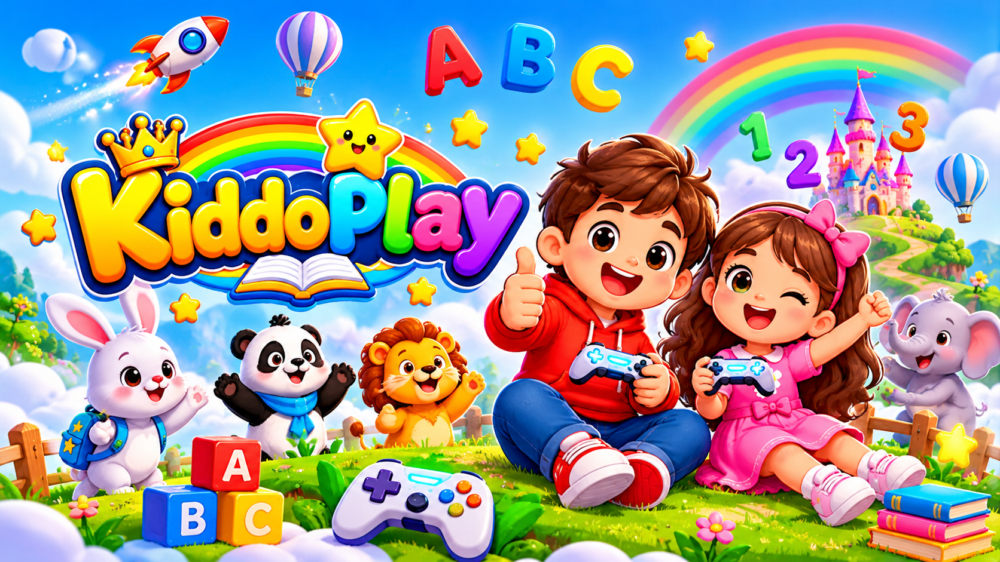

# 🎈 KiddoPlay (কিডোপ্লে) — শিশুদের শেখার ও খেলার রঙিন জগৎ

<div align="center">



[](https://react.dev/)
[](https://www.typescriptlang.org/)
[](https://vitejs.dev/)
[](https://tailwindcss.com/)
[](https://translate.google.com/)
[](https://github.com/jasminaramim/kiddoplay)

**৩ থেকে ১২ বছর বয়সী শিশুদের জন্য বাংলা ও ইংরেজি শেখা, বিশুদ্ধ উচ্চারণ, গণিত, বিজ্ঞান ও ২৬টি দারুণ শিক্ষামূলক খেলার সম্পূর্ণ নিরাপদ প্ল্যাটফর্ম।**

[লাইভ ডেমো দেখুন](http://localhost:3000) · [ফিচারসমূহ](#-প্রধান-বৈশিষ্ট্যসমূহ) · [গেম ক্যাটালগ](#-গেম-ক্যাটালগ-২৬টি-খেলা) · [ইনস্টলেশন গাইড](#-ইনস্টলেশন-ও-চালু-করার-নিয়ম)

</div>

---

## 🌟 প্রধান বৈশিষ্ট্যসমূহ (Key Highlights)

### 🇧🇩 ১. খাঁটি বাংলাদেশি বাংলা কণ্ঠ (Pure Shuddho Bangla Voice Engine)
- কোনো কৃত্রিম বা রোবোটিক টান নয়—বাংলাদেশি বাংলা ভাষার শুদ্ধতম ও মিষ্টি উচ্চারণে প্রতিটি বর্ণ, শব্দ, সংখ্যা এবং ছড়ার বাক্য স্পষ্ট শোনানো হয়।
- ব্যাকএন্ড টিটিএস ইঞ্জিন ও ক্লায়েন্ট অডিও ক্যাশিংয়ের মাধ্যমে যেকোনো ডিভাইস বা ব্রাউজারে নিমিষেই অডিও চালু হয়।
- ভুল বা সঠিক উত্তরের সাথে শিশুদের প্রশংসাসূচক উৎসাহব্যঞ্জক কণ্ঠবার্তা (*"শাবাশ!"*, *"দারুণ হয়েছে!"*, *"আবার চেষ্টা করো!"*)।

### 🎨 ২. কার্টুন ফ্রেন্ডলি ফন্ট ও অ্যানিমেশন (Cartoon Typography & Visuals)
- গুগল ফন্টের জনপ্রিয় কার্টুন ডিসপ্লে ফন্ট **Atma (আত্মা)**, **Fredoka** এবং **Hind Siliguri** ব্যবহার করে তৈরি করা হয়েছে শিশুদের কমিক বইয়ের মতো আকর্ষণীয় বর্ণমালা ও টাইপোগ্রাফি।
- বাউন্সি বাটন, ফ্লোটিং কার্টুন ক্যারেক্টার, রঙিন স্টিকার, কনফেটি পার্টিকেলস এবং চোখ জুড়ানো থিম (রংধনু, সাগর, ক্যান্ডি, সাফারি)।

### 🦜 ৩. টিয়া বন্ধু মাসকট (Interactive Tia Mascot)
- হোমপেজের শীর্ষে ইন্টারঅ্যাক্টিভ টিয়া পাখি শিশুদের মিষ্টি গলায় অভ্যর্থনা জানায় এবং ছড়া আবৃত্তি করে শোনায়।

### 🛡️ ৪. ১০০% নিরাপদ ও অভিভাবক প্যানেল (Parent Dashboard & Safety)
- সম্পূর্ণ বিজ্ঞাপনহীন ও শিশুবান্ধব পরিবেশ।
- কোনো ব্যক্তিগত তথ্য সংগ্রহ ছাড়াই লোকাল ডিভাইসে প্রগ্রেস, স্ট্রিক ও তারা সংরক্ষণ।
- বিষয়ভিত্তিক পারফরম্যান্স, নির্ভুলতার হার ও স্ক্রিন টাইম সচেতনতার পূর্ণাঙ্গ রিপোর্ট।

---

## 🎮 গেম ক্যাটালগ (২৬টি খেলা)

### 🇧🇩 বাংলা স্পেশাল গেম (Bangla Learning & Magic Zone)
1. **🎶 মজার বাংলা ছড়া ও গান (`bangla-rhymes`)**: *আতা গাছে তোতা পাখি*, *ভোর হলো দোর খোলো*, *হাট্টিমাটিম টিম*, *চাঁদ উঠেছে ফুল ফুটেছে* সহ বিখ্যাত সব ছড়া আবৃত্তি ও কুইজ।
2. **🧩 বাংলা শব্দ জাদুকর (`bangla-words`)**: আম, মা, বাবা, ফুল, পাখি, নদী, সূর্য ইত্যাদি বাংলা শব্দ ও যুক্তবর্ণ মেলানোর খেলা।
3. **🔢 ১–১০ বাংলা সংখ্যা ও নামতা মেলা (`bangla-numbers`)**: মিষ্টি ফল ও কিউট প্রাণী গুনে সংখ্যা শেখা এবং সুরে সুরে নামতা আবৃত্তি।
4. **🎨 রংধনু আর্ট ও ড্রয়িং প্যাড (`bangla-drawing`)**: তুলি দিয়ে ছবি আঁকা, কিউট স্ট্যাম্প বসানো এবং বাংলায় রঙের নাম শোনা।
5. **🔤 বাংলা বর্ণমালা ও ইংরেজি (`bangla-english`)**: স্বরবর্ণ, ব্যঞ্জনবর্ণ ও ইংরেজি-বাংলা দ্বিভাষিক শব্দভাণ্ডার।

### 👶 লার্নিং ও ধ্বনি জোন (Learn & Phonics Playground)
6. **এ-বি-সি ধ্বনি ও অক্ষর (`alphabet-phonics`)**: ইংরেজি বর্ণমালা ও ফোনিক্স উচ্চারণ।
7. **১-২-৩ গণনা সাফারি (`counting-safari`)**: সাফারি প্রাণী গুনে সংখ্যার ধারণা।
8. **রং ও আকৃতি মিল (`color-shape-match`)**: জ্যামিতিক আকার ও রঙের মেলবন্ধন।
9. **ইংরেজি শব্দ গঠন (`word-builder`)**: এলোমেলো অক্ষর সাজিয়ে শব্দ তৈরি।
10. **গণিত অভিযান (`math-adventure`)**: যোগ, বিয়োগ, গুণ ও ভাগের রোমাঞ্চকর ধাঁধা।
11. **প্রাণীর ডাক কুইজ (`animal-sounds`)**: বিভিন্ন পশুপাখির আসল ডাক শুনে প্রাণী চেনা।
12. **ছবি ও শব্দ মিল (`picture-word-match`)**: ছবির সাথে দ্বৈত ভাষার সঠিক শব্দ মেলানো।
13. **অক্ষর ও সংখ্যা লেখা (`letter-tracing`)**: স্ক্রিনে আঙুল ঘুরিয়ে হাত ঘোরানো ও ড্রয়িং গাইড।
14. **বিশ্ব ভ্রমণ কুইজ (`world-explorer`)**: বিভিন্ন দেশের পতাকা, রাজধানী ও মহাদেশ চেনা।
15. **মহাকাশ অভিযান (`space-explorer`)**: সৌরজগত, চাঁদ, সূর্য ও গ্রহমণ্ডলীর মজার কুইজ।
16. **ঘড়ি ও সময় শেখা (`time-learning`)**: কাঁটার ঘড়ি দেখে ঘণ্টা ও মিনিট বলা।
17. **স্বাস্থ্যকর খাবার বাছাই (`food-sorter`)**: পুষ্টিকর খাবার ও জাঙ্ক ফুড আলাদা করা।
18. **যানবাহন চেনার কুইজ (`vehicle-quiz`)**: ট্রেন, বিমান ও অ্যাম্বুলেন্সের শব্দ শুনে যানবাহন চেনা।
19. **বুদ্ধির খেলা ও ধাঁধা (`brain-booster`)**: প্যাটার্ন ও অমিল খুঁজে বুদ্ধিমত্তা বাড়ানো।

### 🕹️ মজার আর্কেড জোন (Fun Arcade Zone)
20. **🎈 বেলুন ফাটানো মেলা (`balloon-pop`)**: উড়ন্ত সংখ্যা ও বর্ণের বেলুন ফাটিয়ে পয়েন্ট অর্জন।
21. **🃏 মেমোরি কার্ড ম্যাচ (`memory-cards`)**: ৩ডি কার্ড ফ্লিপ করে প্রাণীদের জোড়া মেলা।
22. **🍓 ফল ধরার খেলা (`fruit-catcher`)**: ঝুড়ি সরিয়ে রসালো ফল ধরা ও বোমা এড়িয়ে চলা।
23. **🐶 কুকুরছানা বনাম বিড়ালছানা (`tic-tac-toe`)**: বুদ্ধিদীপ্ত টিক-ট্যাক-টো দ্বৈরথ।
24. **🐹 মাঠের ইঁদুর ট্যাপ (`whack-a-mole`)**: গর্ত থেকে উঁকি দেওয়া দুষ্টু ইঁদুর ধরা।
25. **🎹 সুরেলা রঙের খেলা (`simon-says`)**: আলো ও সুরের ক্রম মনে রেখে ট্যাপ করা।
26. **🦖 ডাইনো স্টার ড্যাশ (`dino-jump`)**: লাফালাফি করে কাঁটাগাছ পেরিয়ে তারা সংগ্রহ।

---

## 🛠️ প্রযুক্তি ও আর্কিটেকচার (Tech Stack)

- **Frontend**: React 19, TypeScript, Vite 8, Tailwind CSS v4, Motion (Framer Motion v12)
- **Voice / Audio**: Web Audio API (Synthesizer & Sound Effects), Google Native Bangladeshi Speech Engine (/api/tts), Gemini Flash Lite TTS
- **Icons & Graphics**: Lucide React, Custom SVG Cartoon Banner Art, High-Resolution Game Cards
- **Fonts**: Google Fonts (`Atma`, `Fredoka`, `Hind Siliguri`, `Noto Sans Bengali`, `Nunito`)

---

## 🚀 ইনস্টলেশন ও চালু করার নিয়ম (Quick Start)

### ১. রিপোজিটরি ক্লোন করুন
```bash
git clone https://github.com/jasminaramim/kiddoplay.git
cd kiddoplay
```

### ২. ডিপেনডেন্সি ইনস্টল করুন
```bash
npm install --legacy-peer-deps
```

### ৩. ডেভেলপমেন্ট সার্ভার চালু করুন
```bash
npm run dev
```

ব্রাউজারে ওপেন করুন: **[http://localhost:3000](http://localhost:3000)**

### ৪. প্রোডাকশন বিল্ড তৈরি করুন
```bash
npm run build
npm run preview
```

---

## 📁 ফোল্ডার স্ট্রাকচার (Project Structure)

```
kiddoplay/
├── public/                 # Static assets (kiddoplay.png, hero.png, video.mp4)
├── src/
│   ├── assets/             # Images, vectors & videos
│   ├── components/
│   │   ├── common/         # Navbar, Footer, GameCard, StarCounter, etc.
│   │   ├── games/          # 26 Interactive Game Components
│   │   └── views/          # HubView, BadgesView, DailyChallengesView, ParentDashboard
│   ├── context/            # KiddoContext (State Management, Progress, Sound)
│   ├── data/               # Games catalog, learning content, rhymes, namta
│   ├── types/              # TypeScript definitions
│   └── utils/              # Pure Audio Manager, Speech Utils, Confetti
├── server.ts               # Express server with Native Bangla TTS proxy
├── vite.config.ts          # Vite configuration
└── package.json            # Dependencies & scripts
```

---

<div align="center">

**বাংলাদেশের প্রতিটি ছোট্ট সোনামণির রঙিন শৈশব ও আনন্দময় শিক্ষার জন্য পরম ভালোবাসায় তৈরি ❤️ কিডোপ্লে**

</div>
